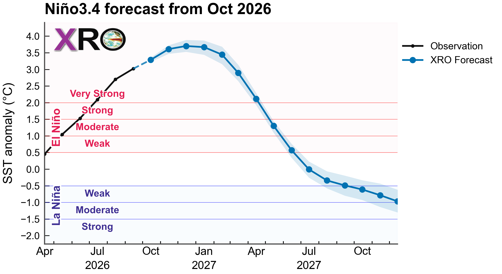
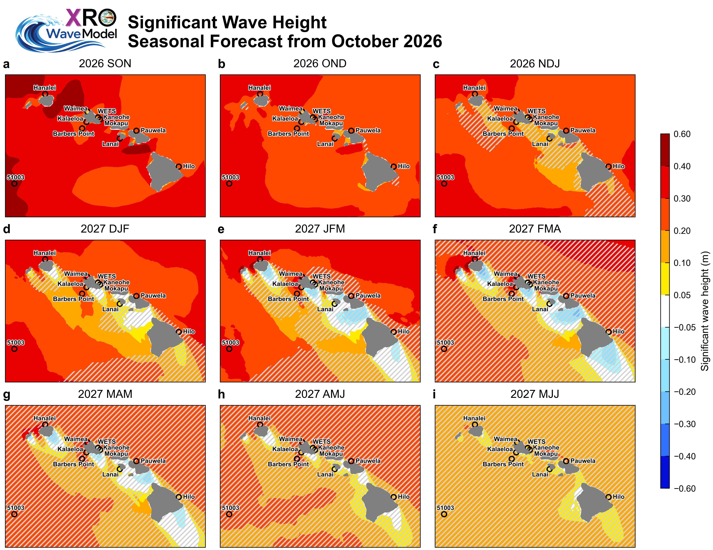
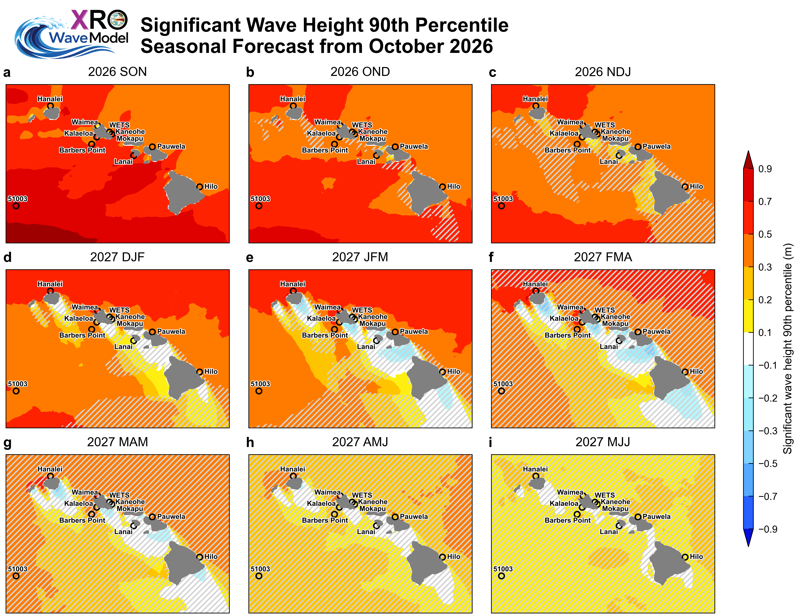

## Seasonal ENSO Forecast
El Niño conditions have continued to intensify across the tropical Pacific, with sea surface temperature (SST) anomalies in the Niño3.4 region (5°S–5°N, 170°–120°W) reaching approximately +3.0°C in September 2026, consistent with our previous XRO forecasts issued from May through August 2026. The latest October XRO forecast projects further intensification, with Niño3.4 SST anomalies exceeding +3.5°C in November 2026 and peaking near +3.7°C during December 2026–January 2027. This suggests an exceptionally strong El Niño event, potentially among the strongest in the past 150 years, if the forecast is realized. The forecast further indicates a gradual weakening during spring 2027, followed by a fast transition toward neutral conditions in summer and La Niña conditions by autumn 2027 (Figure 1).

{#fig1}
/// caption
Figure 1. Seasonal ENSO forecasts based on the Niño3.4 sea surface temperature (SST) anomalies (120-170W, 5S-5N, °C) from October 2026 using the XRO (blue).
///

## Hawaii Wave Seasonal Outlook
The ongoing super El Niño has already contributed to exceptionally high wave activity around the Hawaiian Islands during September 2026, and its influence is expected to continue through the coming fall and winter seasons. Figures 2 and 3 show forecasts of seasonal-mean and 90th-percentile significant wave height (SWH) anomalies, respectively, from September–November (SON) 2026 through May–July (MJJ) 2027. Widespread positive SWH anomalies are projected across Hawaiian waters during fall 2026, with enhanced wave activity particularly along north- and northwest-facing shores. These anomalies are expected to persist through winter 2026–27, with the largest increases exceeding +0.4 m in mean SWH and +0.7 m in the 90th percentile over the northern and western offshore waters.

The projected enhancement of wave activity is consistent with a strengthened North Pacific jet stream, an equatorward shift of the storm track, and increased North Pacific swell generation, characteristic of strong El Niño winters ([Stopa & Cheung, 2014](https://doi.org/10.1002/2013JC009729); [Zhao et al., 2025](https://doi.org/10.1029/2024GL113127)). In contrast, south- and southeast-facing shores are expected to experience weaker or near-neutral anomalies, particularly during spring 2027. Forecast confidence generally decreases at longer lead times, as indicated by the expanding areas of lower forecast skill.

{#fig2}
/// caption
Figure 2. Seasonal mean significant wave height anomaly outlook issued in October 2026 from the XROWaveModel. Hatched areas denote regions where the corresponding hindcast anomaly correlation coefficient (ACC) evaluated over the 1980–2024 period, is below 0.5, suggesting reduced forecast skill and lower confidence in the predicted anomalies.
///

{#fig3}
/// caption
Figure 3. Outlook of seasonal 90th percentile significant wave height anomalies (m) issued in October 2026 from the XROWaveModel. Hatched areas denote regions where the corresponding hindcast anomaly correlation coefficient (ACC) evaluated over the 1980–2024 period, is below 0.5, suggesting reduced forecast skill and lower confidence in the predicted anomalies.
///

